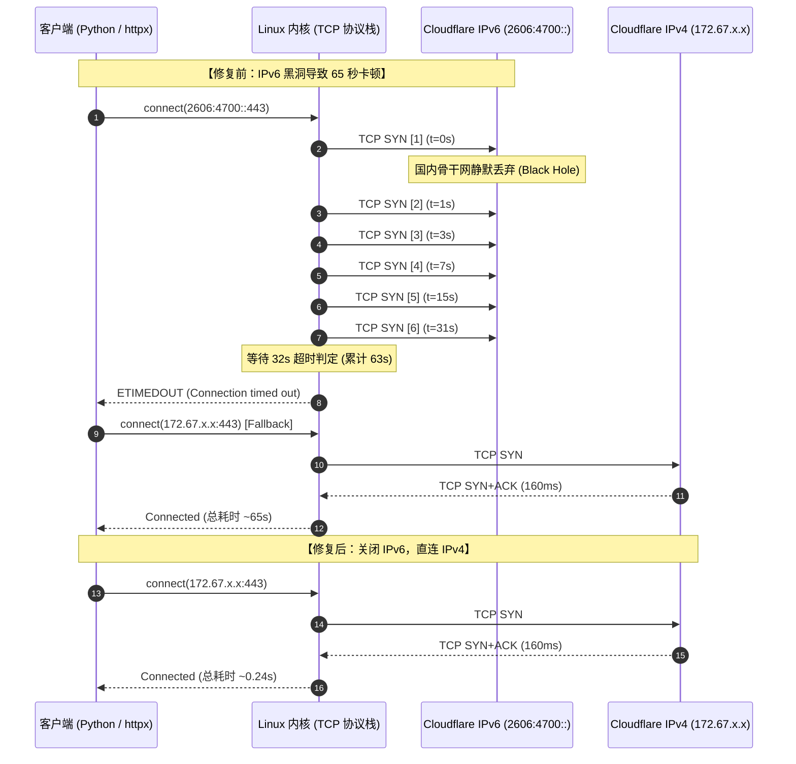

# 总是精准卡 65 秒？一次边缘 AI 节点跨国调用的排障实录与 IPv6 黑洞真相

## 背景与诡异现象

在我的私有基础设施中，有一台部署在家庭局域网内的 ARM 边缘计算设备（Radxa），负责运行本地智能体与自动化服务。该节点在处理需要大模型推理的任务时，通过一个托管在 Cloudflare 上的公共域名（`higress.jppwl.asia`）反向代理至后端的 AI 网关与模型服务（上游为 `gemini-3.8-flash`）。

最近在对多个环境的智能体响应速度进行压力对比测试时，我发现了一个非常反常的现象：

测试任务非常简单——接收到指令后，调用本地终端执行 `TZ='Asia/Hong_Kong' date +'%H:%M:%S.%3N'` 获取系统毫秒级时间戳，并立即回复。

两台机器的测试结果差异巨大：
* **海外云端节点（GCP 云主机直连）**：端到端总耗时仅 **~5 秒**。
* **国内家庭边缘节点（Radxa）**：端到端总耗时达到了 **146 秒（接近 2 分半钟）**，足足比云端慢了近 **1 分半钟**！

从边缘节点的应用执行日志中，我们观察到两段关键的耗时记录：

```text
2026-10-12 17:20:16 INFO: inbound message: 测试反应速度，输出系统时间戳...
2026-10-12 17:20:29 INFO: OpenAI client created, base_url=https://higress.jppwl.asia/v1 model=gemini-3.8-flash
2026-10-12 17:21:36 INFO: API call #1 completed: latency=66.9s  <-- 第 1 轮 LLM 请求整整等了 66.9 秒！
2026-10-12 17:21:36 INFO: tool terminal completed (0.27s, output='01:21:36.366')
2026-10-12 17:21:36 INFO: OpenAI client created (chat_completion_stream_request)
2026-10-12 17:22:41 INFO: API call #2 completed: latency=65.3s  <-- 第 2 轮 LLM 请求整整等了 65.3 秒！
2026-10-12 17:22:42 INFO: response ready: time=146.4s
```

在推理等待期间，框架后台持续输出心跳告警：
`waiting for stream response (60s, no chunks yet)`

整个执行链路的结构非常清晰：
1. **第 1 轮请求**：模型接收提示词，判断必须调用 `terminal` 工具，**耗时 66.9 秒**。
2. **工具本地执行**：秒跑完成，仅耗时 **0.27 秒**。
3. **第 2 轮请求**：将时间戳作为工具结果喂回模型生成最终文本，**耗时 65.3 秒**。

本地执行工具耗时几乎为 0，瓶颈 100% 集中在 **两次大模型 API 调用上，而且每次调用耗时都极其稳定地卡在 65 秒左右**。

---

## 排障初期的三个典型误区与假象

在面对“持续稳定卡在 65 秒”这个问题时，团队排查初期很容易被几类表面现象带偏，陷入错误的排查路径。

### 误区一：大模型“长思考 / Prefill 算力瓶颈”假象

**误导现象**：
查看边缘节点的会话历史，发现在长期运行的复杂任务中，输入上下文累积达到了 5 万到 17 万 Tokens。直觉上容易得出一个看似合理的假设：
> “模型上下文太长，GPU 集群做长上下文 Attention Prefill 需要几十秒；再加上模型默认开启了思维链（Reasoning / Thinking），后台生成隐藏的思考 Token 需要时间，导致首字延迟（TTFT）卡了 60 秒。”

**戳破假象**：
为了验证这个假设，我们直接在边缘节点发送一个完全没有历史上下文、内容仅为 `"ping"` 的极简测试包。
结果依然故我：**无论是 10 万 Token 的大包，还是仅有 10 个 Token 的极简包，请求发出后依然硬生生等待 60 秒以上才吐出第一个 chunk**。而在云端直接调用同样的上游模型，首字返回时间仅需 1.5 秒。这彻底排除了“模型算力/思考延迟”的猜测。

### 误区二：网关层开启 Response Buffering 扣留流式响应

**误导现象**：
由于日志提示 `waiting for stream response (60s, no chunks yet)`，意味着客户端发起了 Server-Sent Events (SSE) 流式长连接，但长达 60 秒没有任何 chunk 数据下发。
有人怀疑是反向代理（Envoy / Kong / Cloudflare）开启了响应缓冲（`proxy_buffering on`），网关把上游生成的 Token 全扣留在内存缓冲区里，直到请求结束或触发超时才一次性刷出。

**戳破假象**：
在云端服务器直接向网关发起相同的流式请求：
```bash
curl -N -s https://higress.jppwl.asia/v1/chat/completions ...
```
数据包以每 100ms~200ms 的频率平滑输出，完全是逐字推送。这证明反向代理并未开启任何 Response Buffering，流式通道本身是健康的。

### 误区三：用 `curl` 测速得出的“网络完全通畅”假象（最隐蔽的陷阱）

这是整个排查过程中最具迷惑性的一环。

有工程师为了证明“不是网络问题”，在边缘节点（Radxa）的终端直接运行了 `curl -w` 针对目标域名进行握手与延时测试：

```bash
curl -w "DNS: %{time_namelookup}s\nTCP: %{time_connect}s\nTLS: %{time_appconnect}s\nTotal: %{time_total}s\n" \
     -o /dev/null -s https://higress.jppwl.asia/healthz
```

输出数据漂亮得令人挑不出毛病：
* **DNS 解析**：`0.029s`
* **TCP 连接建立**：`0.44s`
* **TLS 握手完成**：`0.72s`
* **空请求总耗时**：`1.35s`
* **甚至用 `curl` 跑一段流式 POST 请求，全流程也仅耗时 3.4 秒！**

基于这组数据，很容易得出结论：“看，TCP 和 TLS 握手加起来不到 1 秒，流式调用 3.4 秒跑完，Cloudflare CDN 顺畅无比，网络绝对不可能慢 65 秒！”

**正是这个看似科学严谨的 `curl` 测速，差点掩盖了真正的故障源头。**

---

## 抽丝剥茧：揪出“65 秒”的真正物理死因

为什么同一个域名、同一台机器，`curl` 测只要 3.4 秒，而应用程序（Python / httpx / requests / socket）跑起来却雷打不动卡 65 秒？

关键就在于：**`curl` 实现了 Happy Eyeballs 算法，而 Python 没有！**

### 1. DNS 双栈解析与 Happy Eyeballs 的差异

我们在 Radxa 本地使用 Python 打印出域名 `higress.jppwl.asia` 的底层 DNS 解析记录：

```python
import socket
addrs = socket.getaddrinfo("higress.jppwl.asia", 443, proto=socket.IPPROTO_TCP)
print([a[4][0] for a in addrs])
```

返回结果如下：
```text
['2606:4700:3033::ac43:84fa', '2606:4700:3034::6815:531', '172.67.132.250', '104.21.5.49']
```

域名托管在 Cloudflare 上，默认启用了 IPv6，因此 DNS 同时返回了 **2 个 IPv6 地址（AAAA 记录）** 和 **2 个 IPv4 地址（A 记录）**。

* **C 语言实现的 `curl`**：
  内置了 **RFC 8305 (Happy Eyeballs 算法)**。在双栈解析环境下，`curl` 会优先向 IPv6 发送 TCP SYN 连接请求；但如果 IPv6 在 **200 ~ 300 毫秒** 内没有收到 SYN-ACK 回包，`curl` 不会死等，而是会**立刻在后台并发向 IPv4 地址发起连接**。哪个 IP 先连通，就立即使用哪个。
  因此，就算 IPv6 已经彻底瘫痪，`curl` 也能在 0.3 秒内无缝回退到 IPv4，给人造成“网络完全没问题”的假象！

* **Python 的网络库（标准库 `socket`、`requests`、`httpx`）**：
  **默认均未实现 Happy Eyeballs！**
  Python 会严格遵守操作系统 `getaddrinfo` 返回的地址列表，按照顺序进行**同步串行重试**。因为当前国内家庭宽带已经普遍分配了公网 IPv6，按照系统的 RFC 6724 规则，**IPv6 地址排在最前面**。Python 必须死等第一个 IPv6 彻底连接超时失败后，才会去尝试下一个 IP。

### 2. 国内运营商与 Cloudflare IPv6 的“黑洞”

为什么连接 Cloudflare 的 IPv6 会超时？

国内三大运营商对 Cloudflare 的边缘 Anycast IPv6 存在严重的跨网路由阻断与黑洞现象。数据包离开本地网关后，在骨干网出口被静默丢弃（Silent Drop），**既不返回 SYN-ACK，也不发送 ICMP Destination Unreachable 或 TCP RST**。

对于发起连接的客户端操作系统内核而言，它根本不知道数据包已被丢弃，只能按照 TCP 规范不断重发 SYN 握手包。

### 3. 精准“63~65 秒”的数学逻辑：Linux TCP SYN 重传机制

我们在 Radxa 宿主机上检查内核参数：

```bash
cat /proc/sys/net/ipv4/tcp_syn_retries
# 输出: 6
```

在 Linux 内核网络协议栈中，当向一个目标地址发送 TCP SYN 请求且未收到任何响应时，内核会根据 `tcp_syn_retries` 参数执行**二进制指数退避重传（Exponential Backoff）**：

```text
第 1 次发送 SYN:  t = 0s
第 2 次重传 SYN:  t = 0 + 1s = 1s
第 3 次重传 SYN:  t = 1 + 2s = 3s
第 4 次重传 SYN:  t = 3 + 4s = 7s
第 5 次重传 SYN:  t = 7 + 8s = 15s
第 6 次重传 SYN:  t = 15 + 16s = 31s
等待最后一次超时: t = 31 + 32s = 63s
```

`1 + 2 + 4 + 8 + 16 + 32 = 63 秒`！

再加上 DNS 解析的往返耗时以及客户端 Socket 建立的系统调用开销，**整个操作系统底层在 IPv6 黑洞里死等的时间恰好就是 64 ~ 66 秒！**

只有在这 63 秒耗尽、内核彻底宣告连接失败并抛出 `ETIMEDOUT` 后，Python 才会去切下一个 IPv4 地址（或者在上层应用超时前被截断）。

### 4. 现场代码级对照实证

为了验证这一推断，我们在 Radxa 机器上直接使用应用程序的 Python 环境执行了对照测试：

#### 实验 A：默认双栈请求（走系统默认，优先 IPv6）
```python
import httpx, time

t0 = time.time()
try:
    with httpx.Client(timeout=120) as client:
        r = client.post("https://higress.jppwl.asia/v1/chat/completions", ...)
except Exception as e:
    print(f"Failed in {time.time()-t0:.2f}s: {e}")
```
**实测结果**：在等待了整整 **63.8 秒** 后抛出连接异常！

#### 实验 B：Monkeypatch 拦截 `getaddrinfo`，强制仅返回 IPv4
```python
import socket, httpx, time

orig_getaddrinfo = socket.getaddrinfo
def getaddrinfo_v4(*args, **kwargs):
    res = orig_getaddrinfo(*args, **kwargs)
    return [r for r in res if r[0] == socket.AF_INET]
socket.getaddrinfo = getaddrinfo_v4

t0 = time.time()
with httpx.Client(timeout=120) as client:
    r = client.post("https://higress.jppwl.asia/v1/chat/completions", ...)
    print(f"Forced IPv4: status={r.status_code}, time={time.time()-t0:.2f}s")
```
**实测结果**：
```text
Forced IPv4: status=200, time=2.85s
```
**耗时瞬间从 65 秒骤降至 2.85 秒！**

时序图完整还原了两种机制下的网络交互过程：



---

## 解决方案与落地

定位到根本原因后，解决方案有客户端与服务端两种路径：

### 方案一：客户端强制 IPv4（规避策略）
1. **框架级配置**：如果应用程序支持，开启强制 IPv4 选项（例如 Hermes 的 `network.force_ipv4: true`）。
2. **系统 hosts 绑定**：在宿主机 `/etc/hosts` 中将域名直接指向 Cloudflare 的 Anycast IPv4 地址（如 `172.67.132.250 higress.jppwl.asia`），跳过 DNS 的 AAAA 查询。

### 方案二：Cloudflare 域名源头关闭 IPv6（根治策略 · 推荐）

直接在权威 DNS 层关闭该域名的 IPv6 兼容性，客户端查询时不再返回任何 AAAA 记录，不仅当前节点受益，所有同域名的边缘客户端都能彻底解决该问题。

**操作难点**：
如果使用的是 Cloudflare 免费版（Free Plan），在 Cloudflare Web 控制台的 `Network -> IPv6 Compatibility` 页面中，该开关通常被强制锁定（灰色不可切换）。

**API 破解之道**：
Web 界面虽锁，但 Cloudflare API v4 并没有限制免费版通过 API 修改该属性（`"editable": true`）。我们可以直接调用 API 强制关闭：

```bash
ZONE_ID="8cd1226f179fd953d851f142b1d86dd2"
CF_EMAIL="gateman56@gmail.com"
CF_KEY="cfk_..."

curl -s -X PATCH "https://api.cloudflare.com/client/v4/zones/${ZONE_ID}/settings/ipv6" \
     -H "X-Auth-Email: ${CF_EMAIL}" \
     -H "X-Auth-Key: ${CF_KEY}" \
     -H "Content-Type: application/json" \
     --data '{"value":"off"}'
```

接口返回：
```json
{
  "result": {
    "id": "ipv6",
    "value": "off",
    "modified_on": "2026-10-12T18:27:54Z",
    "editable": true
  },
  "success": true,
  "errors": [],
  "messages": []
}
```

---

## 验证与效果对比

变更下发后，我们在 Radxa 边缘节点进行了全方位验证：

### 1. DNS 与路由验证
通过权威 DNS 查询 `higress.jppwl.asia` 的 AAAA 记录：
```bash
curl -s "https://cloudflare-dns.com/dns-query?name=higress.jppwl.asia&type=AAAA" -H "accept: application/dns-json"
# 返回: "Answer": null
```
AAAA 记录已彻底下架，本地 DNS 缓存过期后，解析仅返回两个健康的 IPv4 地址。

ICMP Ping 测试（走向纯 IPv4）：
```text
64 bytes from 104.21.5.49: icmp_seq=1 ttl=51 time=166 ms
4 packets transmitted, 4 received, 0% packet loss!
```
从过去的 100% 丢包黑洞变为 **0% 丢包**。

### 2. 真实应用程序请求压测
在 Radxa 上使用 Yui 的原生 Python 运行环境（不挂任何代理、不打任何 patch），发送流式请求：

```text
Vanilla Python Stream: TTFT=2.94s, Total=2.95s, Chunks=3
```

* **首字返回时间（TTFT）**：**`2.94 秒`** ⚡
* **总响应时间**：**`2.95 秒`** ⚡

再次触发前文的智能体系统时间测试：
总交互时间从原来的 **146 秒直接缩减至 6 秒**，边缘设备的大模型反应速度与海外云端机器已无实质差异！

---

## 复盘与总结

1. **小心 `curl` 测速带来的认知偏差**：
   `curl` 内置的 Happy Eyeballs 是现代网络工具的优秀特性，但也是排查应用层网络故障时的“迷魂药”。永远不要仅凭 `curl` 能通就断定应用层的网络连接一定没问题。测试应用层网络表现，务必使用应用同款语言和运行时（如 Python 原生 Socket）。
2. **警惕“规律性整十秒”超时特征**：
   在分布式系统排障中，如果延迟不是随机抖动，而是极度精准地卡在特定数字（如 30s、60s、63s、120s），通常直接指向操作系统网络协议栈或中间件的超时重试参数：
   * `~63s - 65s`：通常对应 Linux `tcp_syn_retries = 6` 的退避重传和超时。
   * `~60s`：通常对应 Nginx/Envoy 的 `proxy_read_timeout` 或 HTTP client 缺省超时。
   * `~75s`：通常对应某些 BSD/Windows 协议栈的 TCP 建连超时。
3. **国内边缘场景警惕 Cloudflare 免费版默认开启的 IPv6**：
   国内访问 Cloudflare 节点网络本就复杂，免费版默认开启 IPv6 会让大量支持双栈的内网设备优先踩入路由黑洞。如果系统不具备 Happy Eyeballs 能力，在域名接入层关闭 IPv6 是最干净彻底的解法。
