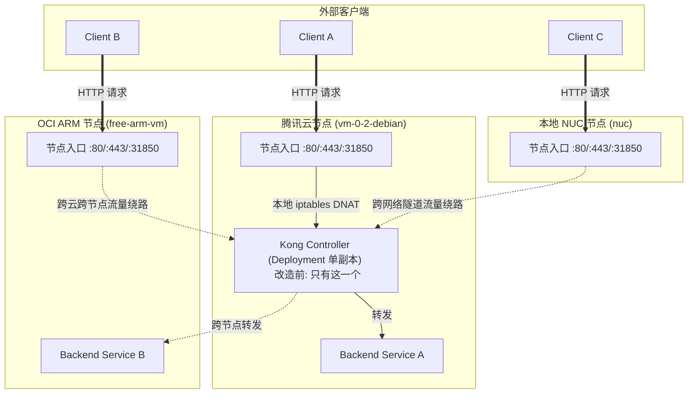
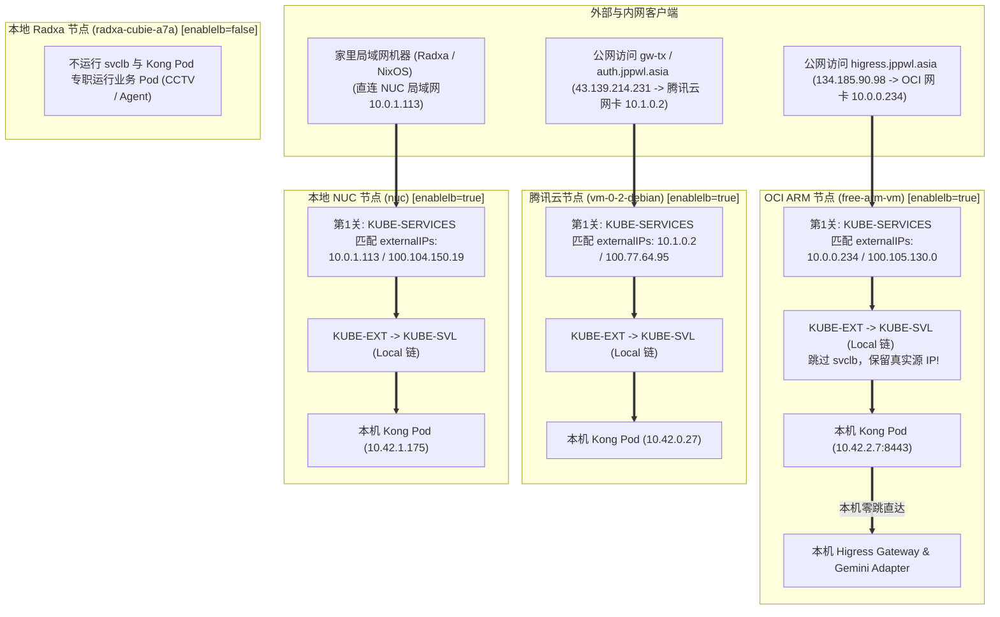

# 云原生网关高可用演进：基于 Kong DaemonSet 与 Local 流量亲和力的跨节点零绕路改造（含 K3s svclb 伪装源 IP 导致 Local 策略失效的深度复盘）

在跨云及混合云（Cloud & Homelab Edge）部署 Kubernetes (K3s) 集群的场景中，API 网关作为整个系统的流量入口，其部署架构与网络转发策略直接决定了服务的延迟、可用性与安全性。

本文分两部分记录对 Kong Ingress Controller（KIC）的高可用与网络链路改造：
1. **第一阶段（基础改造）**：通过 GitOps 声明式配置完成从 Deployment 到 DaemonSet 的演进，开启 `externalTrafficPolicy: Local` 与 L4 Stream 转发。
2. **第二阶段（生产深水区排障与架构修正）**：上线两个月后，在发送 165k tokens（~500KB JSON Body）的 LLM 长上下文请求时，频繁遭遇 300 秒无输出超时。顺着容器日志与宿主机内核 `iptables` 链计数器一路追查，拮出了第一阶段验证时的一个致命盲区——**第一阶段用 `:31850` (NodePort) 验证时绕过了 `svclb`，而生产 `:80/:443` 流量经过 K3s `svclb` 容器时被 `MASQUERADE` 篡改源 IP 为 Pod 网段 `10.42.2.254`，导致 `kube-proxy` 将公网入站流量误判为集群内部 Pod 流量，`externalTrafficPolicy: Local` 命中率实际为 0%**。第七节完整记录了这次从现象到内核规则链的排查、三种修复方案的取舍以及最终的 GitOps 落地校验。

---

## 一、 现状盘点与痛点分析

现有的 K3s 业务集群（`tencent-dp1-cluster`）由跨网络组网的异构节点构成，节点间通过 Tailscale 组网，Flannel VXLAN 跑在 `tailscale0` 网卡之上：
1. **腾讯云节点 (`vm-0-2-debian`)**：云端控制面及国内公网接入节点（公网 IP `43.139.214.231` DNAT 至网卡 `eth0` `10.1.0.2`，Tailscale IP `100.77.64.95`）。
2. **OCI ARM 节点 (`free-arm-vm`)**：海外公有云高算力节点（4C24G ARM，公网 IP `134.185.90.98` DNAT 至网卡 `enp0s6` `10.0.0.234`，Tailscale IP `100.105.130.0`），承载 Higress AI Gateway、LiteLLM、Redis 等核心数据面服务。
3. **本地 NUC 节点 (`nuc`)**：Homelab x86 计算节点（局域网 IP `10.0.1.113`，Tailscale IP `100.104.150.19`）。
4. **本地 Radxa 节点 (`radxa-cubie-a7a`)**：Homelab ARM 边缘节点（局域网 IP `10.0.1.105`，Tailscale IP `100.115.214.26`），专职运行 CCTV 视频流采集与本地 Agent。

在最初的架构中，网关层面临三个结构性缺陷：

### 1. 控制面/数据面 Pod 存在单点故障与跨节点漫游
原有的 Kong Ingress Controller 采用 K8s `Deployment` 单副本部署在腾讯云主节点上。当 OCI 节点或 NUC 节点的入口收到外部请求时，流量必须通过 Flannel VXLAN 跨节点折返回腾讯云节点上的单点 Kong Pod 进行代理，带来显著的跨网延迟，且单 Pod 故障会导致全集群入口瘫痪。

### 2. `externalTrafficPolicy: Cluster` 导致的额外 SNAT 与源 IP 丢失
Kong Proxy Service 的默认流量策略为 `Cluster`。在该模式下，节点收到流量后会按全集群 Endpoints 随机转发到其他节点的 Kong Pod，并强制进行源地址转换（SNAT），不仅增加内部网络跳数，还导致后端服务无法获取客户端真实 IP。

### 3. 缺乏 L4 (TCP Stream) 传输能力
默认的 Kong 部署仅启用了 HTTP/HTTPS (80/443) 端口代理。对于 Redis (6379)、Kafka (9092) 等四层 TCP 流量，未开启 Nginx Stream 模块，缺乏 L4 TCP 透传能力。

---

## 二、 第一阶段：DaemonSet + Local 策略 + L4 Stream 基础改造

### 1. 改造前拓扑：单点集中 + 跨节点强制绕路

> **关于 K3s 端口映射的准确说明**：
> 在 K3s 中，`type: LoadBalancer` 的 Service 会同时涉及两层组件：
> 1. **`svclb` 容器（Klipper-LB DaemonSet）**：由 K3s `servicelb` 控制器自动在 `kube-system` 下生成，通过 CNI `hostPort` 接管宿主机的 **`80 / 443 / 6379 / 9092`** 端口，在 `svclb` 容器内部的独立 Network Namespace 中将流量 DNAT 并 `MASQUERADE` 到宿主机的 NodePort（`31850 / 31324 / 30745 / 30818`）。
> 2. **宿主机 `kube-proxy`（内核 `iptables`）**：管理 NodePort（`:31850` 等）、ClusterIP、ExternalIP 的 `KUBE-SERVICES` / `KUBE-NODEPORTS` / `KUBE-EXT` / `KUBE-SVL` 转发链，决定将数据包发往哪个节点的 Kong Pod。



---

### 2. 第一阶段的三项改造目标

所有改造通过修改 GitOps 仓库 `nvd11/my-argocd-manifests` 中的 `argocd-apps/kong-controller-app.yaml` 由 ArgoCD 自动同步：

1. **目标 1：将 Controller 调整为 DaemonSet 模式**
   设置 `deployment.daemonset: true`，摆脱 `replicas` 硬编码限制。Kong Chart 的 `deployment.yaml` 模板在 `daemonset: true` 时会渲染为 `DaemonSet` 并省略 `replicas` 字段。
2. **目标 2：配置 `externalTrafficPolicy: Local`**
   在 Kong Proxy Service 中开启 `Local` 流量策略。注意部署顺序：必须先让 DaemonSet 在目标节点全量 Ready，再切换 `externalTrafficPolicy: Local`，否则无本地端点的节点会直接丢弃流量。
3. **目标 3：开启 Nginx Stream (TCP 6379 / 9092) 转发能力**
   在 `proxy.stream` 列表中声明 `containerPort` 与 `servicePort`。**切记不要手动设置 `env.nginx_stream_listen`**——Chart 的 `helpers.tpl` 中 `kong.streamListen` 会根据 `proxy.stream` 自动生成 `KONG_STREAM_LISTEN` 环境变量，手动注入 `nginx_stream_listen` 会被当成裸 nginx 指令写入 `nginx-kong-stream.conf`，触发 `"listen" directive is not allowed here` 导致 Pod `CrashLoopBackOff`。

### 3. 第一阶段的验证与当时留下的“假阳性”伏笔

第一阶段部署后，当时使用了对节点 **NodePort `:31850`** 直接发起 HTTP 请求的方式验证 `externalTrafficPolicy: Local`：

```bash
# 当时直接打 NodePort 31850 的测试命令：
$ curl http://100.105.130.0:31850/svc2
$ kubectl logs -n kong-system kong-ingress-controller-kong-rxn4r -c proxy | grep "GET /svc2"
100.115.214.26 - - [02/Aug/2026:17:54:31] "GET /svc2" 307
```

当时看到：打 OCI 的 `:31850` 只有 OCI 的 Kong 收到请求，且日志中保留了真实客户端 IP `100.115.214.26`，便以为 `externalTrafficPolicy: Local` 已经全链路生效。

**然而，这个测试有一个致命盲区：直接访问 `:31850` (NodePort) 绕过了 K3s 的 `svclb` 容器，而生产域名流量走的是 `:80` 和 `:443` 端口！**

---

## 三、 第二阶段：165k Token 请求 300s 超时引出的真相调查

### 1. 故障现象：为什么 165k Token 的 LLM 请求会卡死 5 分钟无输出？

2026 年 10 月，跑在家里 Radxa 节点上的 Agent (Yui) 通过公网域名 `https://higress.jppwl.asia/v1/chat/completions`（DNS A 记录指向 `free-arm-vm` 公网 IP `134.185.90.98:443`）调用部署在 `free-arm-vm` 上的 Higress AI Gateway 与 `higress-gemini-adapter`。

当会话上下文累积到 `165,047` tokens（HTTP POST Body 约 `491 KB`）时，Agent 日志连续两次报出 300 秒流超时，第三次重试却在 56 秒内秒回：

```text
# Yui Agent 日志 (~/.hermes-yui/logs/agent.log)
13:29:13 -> 13:34:13  WARNING: Stream stale for 300s (threshold 300s) — no chunks received (attempt 1/3). Killing connection.
13:34:15 -> 13:39:15  WARNING: Stream stale for 300s (threshold 300s) — no chunks received (attempt 2/3). Killing connection.
13:39:21 -> 13:40:17  200 OK (56s, out=57 tokens)
```

一开始怀疑是 Higress 或上游 Gemini API 处理 165k tokens 太慢。但登上 `free-arm-vm` 核对 `higress-gateway` 和 `higress-gemini-adapter` 的容器日志后，发现了第一个反常事实：

### 2. 排查第一步：查 `higress-gateway` 与 `kong` 访问日志

在 `free-arm-vm` 上检查 `higress-gateway` 的 Access Log（`/var/log/pods/higress-system_higress-gateway-*/higress-gateway/0.log`）：

```json
{"start_time":"2026-10-17T13:39:31.896Z","method":"POST","path":"/v1/chat/completions","bytes_received":"491138","response_code":"200","duration":"45745","upstream_service_time":"15016","downstream_remote_address":"10.42.2.252:48106","x_forwarded_for":"10.42.2.254,10.42.2.252"}
```

两个关键线索直接暴露出来：
1. **前两次卡死 300 秒的请求（`13:29:13` 和 `13:34:15`），在 `higress-gateway` 和 `higress-gemini-adapter` 的日志里根本不存在！**而第三次成功到达 Higress 的请求，`upstream_service_time` 只用了 **15.016 秒**。
2. 看 `higress-gateway` 其他时间段的日志，发现 `downstream_remote_address` 和 `x_forwarded_for` 里**99% 的请求源 IP 全是 `10.42.2.254`**，而且转发给 `higress-gateway` (`10.42.2.182`) 的上游 Kong Pod IP 竟然在三个节点之间来回跳：
   * `10.42.2.252`（`free-arm-vm` 本机的 Kong Pod）
   * `10.42.1.156`（家里 `nuc` 节点上的 Kong Pod）
   * `10.42.0.23`（腾讯云 `vm-0-2-debian` 节点上的 Kong Pod）

接着登上家里的 `nuc` (`100.104.150.19`) 查看 NUC 上 Kong Pod (`10.42.1.156`) 的日志，当场抓到了 `13:29:14` 那次失败请求的尸体：

```text
# NUC 节点 (100.104.150.19) 上的 Kong proxy 日志：
2026/10/17 13:29:14 [warn] 1329#0: *84076 a client request body is buffered to a temporary file /kong_prefix/client_body_temp/0000000203, client: 10.42.2.254, server: kong, request: "POST /v1/chat/completions HTTP/1.1", host: "higress.jppwl.asia", request_id: "0a19450713a000051354af0762469675"
10.42.2.254 - - [17/Oct/2026:13:34:18 +0000] "POST /v1/chat/completions HTTP/1.1" 400 0 "-" "OpenAI/Python 2.24.0" kong_request_id: "0a19450713a000051354af0762469675"
```

**300 秒超时的直接死因水落石出**：
1. Yui 把 491KB 的 POST 请求发到海外 `free-arm-vm` (`134.185.90.98:443`)。
2. `free-arm-vm` 上的 `svclb` (`10.42.2.254`) 接到请求后，**没有转给 `free-arm-vm` 本机的 Kong Pod，而是通过 Flannel over Tailscale 隧道跨洋倒回了国内家里 `nuc` 节点上的 Kong Pod (`10.42.1.156`)**！
3. 因为 `Flannel (MTU 1230) over Tailscale (MTU 1280)` 跨洋传输 491KB 突发大包时发生 TCP 窗口/分片卡死，NUC 上的 Kong 只收到了前半截 Body，一直卡在 `a client request body is buffered to a temporary file` 等待客户端发完剩余 Body，根本没往下游 `higress-gateway` 转发。
4. 直到 300 秒后 Yui 超时断开连接，NUC 上的 Kong 记录 HTTP `400` 错误。
5. 第三次重试时，33% 的随机概率终于命中了 `free-arm-vm` 本机的 Kong Pod (`10.42.2.252`)，本机零跨网转给 `higress-gateway`，15 秒就完成了推理！

---

### 3. 排查第二步：为什么 `externalTrafficPolicy: Local` 和禁用 NUC `svclb` 都没拦住跨节点转发？

这里有两个核心疑问：
1. **我们之前已经通过节点标签 `svccontroller.k3s.cattle.io/enablelb=false` 禁用了 NUC 和 Radxa 上的 `svclb`，为什么流量还能发回 NUC 的 Kong Pod？**
   * 因为 `svccontroller.k3s.cattle.io/enablelb=false` 只是让 NUC 上不再运行 `svclb` 入口容器；
   * 但 **Kong DaemonSet 并没有配置 `nodeSelector`**，NUC 上依然跑着 `kong-ingress-controller-kong` Pod (`10.42.1.156`)，并被注册在 `kong-proxy` Service 的全集群 EndpointSlice 池子里。

2. **明明 `kong-proxy` Service 已经配置了 `externalTrafficPolicy: Local`，为什么 `free-arm-vm` 上的 `iptables` 还会把流量按 33% 概率分给 NUC 和腾讯云？**

为了查清这个问题，我们在 `free-arm-vm` 宿主机和 `svclb` 容器的 Network Namespace 中导出了完整的 `iptables -t nat` 规则与包计数器。

--- 

## 四、 根因解剖：K3s `svclb` 的 `MASQUERADE` 如何在底层架空 `externalTrafficPolicy: Local`

### 1. 先理清 Linux VM 宿主机上的三个物理/逻辑实体

在单台 K3s 节点（如 `free-arm-vm`）上，入站流量涉及三个互相独立的层级：
1. **宿主机内核主 `iptables` 实例（由 K3s 内置的 `kube-proxy` 和 CNI 维护）**：掌管宿主机物理网卡的 `PREROUTING` 入站转发，内含 `KUBE-SERVICES`、`CNI-HOSTPORT-DNAT`、`KUBE-NODEPORTS`、`KUBE-EXT-*`、`KUBE-SVC-*`（全局随机链）和 `KUBE-SVL-*`（Local 本地链）。
2. **`svclb` 容器（Pod IP `10.42.2.254`）**：拥有独立的 Network Namespace 和容器内独立的 `iptables` 实例。它不理解什么是 `externalTrafficPolicy`，只负责把进入容器 `443` 端口的包 DNAT 并 `MASQUERADE` 到宿主机 NodePort `100.105.130.0:31324`。
3. **`Kong Pod` 容器（Pod IP `10.42.2.252`）**：真正运行 Kong (Nginx) 进程的容器，监听 `8000` (HTTP) 和 `8443` (HTTPS)。

### 2. 跟踪一个 `443` 公网请求包在 `free-arm-vm` 上的真实流转路径

在 `free-arm-vm` 上查看宿主机 `PREROUTING` 链：

```text
$ sudo iptables -t nat -L PREROUTING -n -v
Chain PREROUTING (policy ACCEPT)
 pkts bytes target              prot opt in out source     destination
5727K  579M KUBE-SERVICES       all  --  *  *   0.0.0.0/0  0.0.0.0/0   /* 第 1 关：kube-proxy Service 入口 */
3041K  359M CNI-HOSTPORT-DNAT   all  --  *  *   0.0.0.0/0  0.0.0.0/0   ADDRTYPE match dst-type LOCAL /* 第 2 关：svclb hostPort 入口 */
```

当客户端（源 IP `120.235.167.137`）访问 `https://higress.jppwl.asia` (`134.185.90.98:443`) 时，OCI 云网关将目标 IP DNAT 为 `free-arm-vm` 网卡 `enp0s6` 的内网 IP **`10.0.0.234:443`** 送入虚拟机：

#### ① 第 1 关：宿主机 `KUBE-SERVICES` 链（因未识别 `10.0.0.234` 而漏过！）
因为 K3s 使用 `--flannel-iface tailscale0` 启动，K3s 只把节点的 Tailscale IP (`100.105.130.0` 和 `100.77.64.95`) 写进了 Service 的 `status.loadBalancer.ingress`。因此 `KUBE-SERVICES` 链里只有匹配 `-d 100.105.130.0` 的规则：

```text
0  0 KUBE-EXT-EIMG3TRSSUL5W4AV  tcp -- * * 0.0.0.0/0  100.105.130.0  /* kong-proxy-tls loadbalancer IP */ tcp dpt:443
```

而公网请求包的目标 IP 是 **`10.0.0.234`**，在第 1 关 `KUBE-SERVICES` 没匹配上，直接漏到了第 2 关 `CNI-HOSTPORT-DNAT`！

#### ② 第 2 关：掉进 `svclb` 容器，源 IP 被 `MASQUERADE` 篡改为 `10.42.2.254`
`CNI-HOSTPORT-DNAT` 不检查目标 IP，只要是 `tcp dpt:443` 就一律 DNAT 给 `svclb` 容器 (`10.42.2.254:443`)。
进入 `svclb` 容器的 Network Namespace 查看其内部 `iptables`：

```text
$ sudo nsenter -t <svclb_pid> -n iptables -t nat -S
-A PREROUTING -p tcp -m tcp --dport 443 -j DNAT --to-destination 100.105.130.0:31324
-A POSTROUTING -d 100.105.130.0/32 -p tcp -j MASQUERADE
```

注意第二行：`svclb` 在把包转发给宿主机 NodePort `100.105.130.0:31324` 时，执行了 **`-j MASQUERADE`**，**把数据包的源 IP 从客户端真实 IP `120.235.167.137` 改写成了 `svclb` 自己的 Pod IP `10.42.2.254`**！

#### ③ 第 3 关：回到宿主机 NodePort `31324` (`KUBE-EXT` 链)，被 `-s 10.42.0.0/16` 规则截胡！
当这个源 IP 已经变成 `10.42.2.254` 的包到达宿主机 `31324` 端口，进入 `kube-proxy` 生成的 `KUBE-EXT-EIMG3TRSSUL5W4AV` 链时，看当时实测的包计数器：

```text
$ sudo iptables -t nat -L KUBE-EXT-EIMG3TRSSUL5W4AV -n -v
Chain KUBE-EXT-EIMG3TRSSUL5W4AV (4 references)
 pkts bytes target                     prot opt in out source         destination
  129  7612 KUBE-SVC-EIMG3TRSSUL5W4AV  all  --  *  *   10.42.0.0/16   0.0.0.0/0   /* Rule 1: pod traffic for kong-proxy-tls external destinations */
    0     0 KUBE-MARK-MASQ             all  --  *  *   0.0.0.0/0      0.0.0.0/0   ADDRTYPE match src-type LOCAL
    0     0 KUBE-SVC-EIMG3TRSSUL5W4AV  all  --  *  *   0.0.0.0/0      0.0.0.0/0   ADDRTYPE match src-type LOCAL
    0     0 KUBE-SVL-EIMG3TRSSUL5W4AV  all  --  *  *   0.0.0.0/0      0.0.0.0/0   /* Rule 4: externalTrafficPolicy: Local -> 本机 Kong Pod */
```

**看第 1 条规则和第 4 条规则的命中数对比（`129 pkts` vs `0 pkts`）**：
* Kubernetes `kube-proxy` 在生成 `externalTrafficPolicy: Local` 的入口链 `KUBE-EXT` 时，第 1 条规则写死了：**如果源 IP 属于集群 Pod CIDR (`-s 10.42.0.0/16`)，说明是集群内部 Pod 访问了 NodePort，直接跳进全局随机链 `KUBE-SVC`**！
* 而 K3s 的 `svclb` 容器自己的 IP 恰好是 `10.42.2.254`（属于 `10.42.0.0/16`）。
* 结果：**所有经过 `svclb` (`:80/:443`) 进来的外部流量，因为被 `svclb` 换上了 `10.42.2.254` 的源 IP，100% 被 `KUBE-EXT` 的第 1 条规则当成“集群内部 Pod 流量”截胡，强行送进 `KUBE-SVC` 按 33% 概率跨网分发给腾讯云、NUC、OCI 三个 Kong Pod！第 4 条 `KUBE-SVL` (Local 链) 永远是 `0 pkts`！**

下图完整还原了为什么第一阶段测 `:31850` 时命中 `KUBE-SVL`，而生产走 `:443` 时却被 `svclb` 送进 `KUBE-SVC` 跨洋绕路：

```mermaid
graph TD
    subgraph PathA ["第一阶段测试路径：直连 NodePort :31850 (绕过 svclb)"]
        CA["Client (源IP: 100.115.214.26)"] -->|"Dst: 100.105.130.0:31850"| NPA["宿主机 KUBE-NODEPORTS (:31850)"]
        NPA --> EXTA["宿主机 KUBE-EXT 链<br/>Rule 1: -s 10.42.0.0/16? 否!<br/>Rule 4: 命中 KUBE-SVL (Local)!"]
        EXTA -->|"100% 本机直达 + 保留源IP"| KongLocalA["free-arm-vm 本机 Kong Pod (10.42.2.252)"]
    end

    subgraph PathB ["生产故障路径：公网 :443 触发 svclb MASQUERADE 乌龙"]
        CB["Client (源IP: 120.235.167.137)"] -->|"OCI 网关 DNAT 为<br/>Dst: 10.0.0.234:443"| Gate1["第1关：KUBE-SERVICES<br/>只认 100.105.130.0，不认 10.0.0.234!<br/>--> 未命中，漏入第2关"]
        Gate1 --> Gate2["第2关：CNI-HOSTPORT-DNAT<br/>DNAT 进 svclb 容器 (10.42.2.254:443)"]
        Gate2 --> Svclb["svclb 容器内部 iptables<br/>1. DNAT -> 100.105.130.0:31324<br/>2. MASQUERADE (源IP被改为 10.42.2.254!)"]
        Svclb -->|"源IP: 10.42.2.254 (Pod网段!)"| EXTB["第3关：宿主机 KUBE-EXT 链 (:31324)<br/>Rule 1: -s 10.42.0.0/16 当场命中!<br/>(被误判为内部 Pod 流量，KUBE-SVL 零命中)"]
        EXTB -->|"跳入全局 KUBE-SVC 随机链"| R1["33% -> 腾讯云 Kong (10.42.0.23)"]
        EXTB -->|"跳入全局 KUBE-SVC 随机链"| R2["33% -> 家里 NUC Kong (10.42.1.156)<br/>500KB 大包跨洋 VXLAN 卡死 300s!"]
        EXTB -->|"跳入全局 KUBE-SVC 随机链"| R3["33% -> 本机 OCI Kong (10.42.2.252)"]
    end
```



---

## 五、 修复方案分析与架构决策

### 1. 为什么不能靠配置 `internalTrafficPolicy: Local` 解决？

有人会问：既然 `svclb` 的源 IP `10.42.2.254` 被当成了内部 Pod 流量，那把 Service 的 `internalTrafficPolicy` 也设为 `Local` 行不行？
答案是**行不通**，原因有两点：
1. **`internalTrafficPolicy` 只作用于 `ClusterIP` (`10.43.193.202`)**，而 `svclb` 转发的目标是宿主机的 `NodePort (:31324)`。在 `NodePort` 的 `KUBE-EXT` 链中，`-s 10.42.0.0/16` 是硬编码跳向 `KUBE-SVC` 的，根本不受 `internalTrafficPolicy` 控制。
2. **Chart 模板限制**：检查 Kong Helm Chart `2.38.0` 的 `templates/_helpers.tpl` 源码，`kong.service` 模板只渲染了 `externalTrafficPolicy` 和 `externalIPs`，并未暴露 `internalTrafficPolicy` 字段。

### 2. 三种可行修复方案的对比

要让 `:80 / :443 / :6379 / :9092` 的入站流量 100% 命中本节点的 `KUBE-SVL` (Local 链)，共有三种方案：

| 维度 | 方案 1：Service 配置 `externalIPs` (保留 `svclb`) | 方案 2：Kong 容器直绑 `hostPort` + `ClusterIP` (移除 `svclb`) | 方案 3：修改各节点 K3s systemd `--node-external-ip` |
| :--- | :--- | :--- | :--- |
| **核心原理** | 在 `proxy.externalIPs` 中显式声明各入口节点的网卡内网 IP 与 Tailscale IP，使入站包在 `PREROUTING` **第 1 关 (`KUBE-SERVICES`)** 直接跳入 `KUBE-EXT -> KUBE-SVL`，不再漏入第 2 关的 `svclb` | 将 `proxy.type` 改为 `ClusterIP` 销毁 `svclb`，由 Kong DaemonSet 自身绑定 `hostPort: 80/443/6379/9092` | 在每台宿主机的 `/etc/rancher/k3s/config.yaml` 中追加网卡内网 IP 到 `node-external-ip` |
| **是否保留 `svclb`** | ✅ 保留 | ❌ 移除 | ✅ 保留 |
| **滚动更新影响** | ✅ **零闪断**（不涉及 Pod `hostPort` 端口争用） | ⚠️ DaemonSet 滚动升级时需先杀旧 Pod 释放 `hostPort` 才能起新 Pod，有 ~10s 闪断 | ⚠️ 需逐台 SSH 改宿主机配置并重启 `k3s-agent` |
| **GitOps 纯粹度** | ✅ **100% GitOps 声明式**（单文件统一管控） | ✅ 100% GitOps 声明式 | ❌ 散落在各节点 `/etc/` 目录下 |
| **真实源 IP 保留** | ✅ 100% 保留 | ✅ 100% 保留 | ✅ 100% 保留 |

**最终决策：选择【方案 1】+ 节点亲和性治理（统一收口至 `svccontroller.k3s.cattle.io/enablelb: "true"`）**。

### 3. 节点拓扑优化：启用 NUC 作为内网网关入口，将 Radxa 彻底移出网关池

在排查过程中，我们还梳理了集群全部 4 个节点的网关职责：
* **`free-arm-vm` (OCI)**：海外公网入口（`10.0.0.234`）+ Tailscale 入口（`100.105.130.0`）。
* **`vm-0-2-debian` (腾讯云)**：国内公网入口（`10.1.0.2`）+ Tailscale 入口（`100.77.64.95`）。
* **`nuc` (家里 x86 节点)**：启用 `svccontroller.k3s.cattle.io/enablelb=true`，专门作为**家里局域网（`10.0.1.113`）与 Tailscale（`100.104.150.19`）的内网网关入口**，供家里内网机器（Radxa、NixOS 笔记本、台式机等）走千兆局域网 `<1ms` 极速调用 K3s 服务。
* **`radxa-cubie-a7a` (家里 ARM 边缘板)**：保持 `svccontroller.k3s.cattle.io/enablelb=false`，并通过在 Kong DaemonSet 上配置 `nodeSelector: svccontroller.k3s.cattle.io/enablelb: "true"`，**让 Kong DaemonSet 与 `svclb` 共用同一个节点标签选择器**，自动将 Kong Pod 从 Radxa 节点撤出，彻底释放 Radxa 的内存与 CPU。

> **顺手解决的 Radxa 节点隐藏故障**：
> 排查时发现 Radxa 节点上的 `kong` 和 `fluent-bit` Pod 之前一直处于 `CrashLoopBackOff`（报 `dial tcp 10.43.0.1:443: i/o timeout`），且宿主机 `6379` 端口还跑着一个 apt 装 `redis-tools` 时顺带拉起的空转 `redis-server.service`。检查 `journalctl -u k3s-agent` 发现，全志 A733 定制内核 `5.15.147-8-a733` 未编译 `CONFIG_IP_NF_TARGET_REJECT` 和 `CONFIG_NFT_FIB_IPV4`，导致 `kube-proxy` 执行 `iptables-restore` 在遇到 `-j REJECT` 时整批失败退出，`KUBE-SERVICES` 链为空。通过在 Radxa 上卸载多余的 `redis-server` 并配置 `/usr/local/sbin/iptables-restore-strip-reject` 将 `-j REJECT` 无损转换为 `-j DROP`，Radxa 的 `KUBE-SERVICES` 规则链与 `fluent-bit` 立即恢复 `1/1 Running`。

---

## 六、 最终修复落地与端到端校验

### 1.修复后的完整目标拓扑



### 2. GitOps 声明式配置变更 (`argocd-apps/kong-controller-app.yaml`)

先为 `nuc` 节点开启 `enablelb=true` 标签：

```bash
$ kubectl label node nuc svccontroller.k3s.cattle.io/enablelb=true --overwrite
```

更新 `nvd11/my-argocd-manifests` 中的 `argocd-apps/kong-controller-app.yaml`：

```yaml
apiVersion: argoproj.io/v1alpha1
kind: Application
metadata:
  name: kong-ingress-controller
  namespace: argocd
  annotations:
    argocd.argoproj.io/sync-wave: "2"
spec:
  project: default
  source:
    repoURL: 'https://charts.konghq.com'
    chart: kong
    targetRevision: 2.38.0
    helm:
      values: |
        ingressController:
          installCRDs: false
        env:
          database: "off"
          # 注意: 不要手动加 nginx_stream_listen! proxy.stream 会自动生成 KONG_STREAM_LISTEN
        gateway:
          enabled: true
        deployment:
          # DaemonSet 模式: 每个启用了 LB 的节点 1 个 controller pod
          daemonset: true
        nodeSelector:
          # 仅在启用了 svclb 的节点 (OCI, 腾讯云, NUC) 运行 Kong, 排除 Radxa
          svccontroller.k3s.cattle.io/enablelb: "true"
        proxy:
          # 设置外部流量策略为 Local, 避免跨节点路由, 就近访问本节点的 Controller Pod
          externalTrafficPolicy: Local
          # 显式声明各节点的网卡内网 IP 与 Tailscale IP, 确保公网 DNAT, 局域网与 Tailscale 流量都在 PREROUTING 第一道关卡直接走本机 KUBE-SVL 本地链
          externalIPs:
            - 10.0.0.234     # OCI free-arm-vm 网卡内网 IP (公网 134.185.90.98 DNAT 落点)
            - 100.105.130.0  # OCI free-arm-vm Tailscale IP
            - 10.1.0.2       # 腾讯云 vm-0-2-debian 网卡内网 IP (公网 43.139.214.231 DNAT 落点)
            - 100.77.64.95   # 腾讯云 vm-0-2-debian Tailscale IP
            - 10.0.1.113     # 本地 NUC 局域网 IP (供家里内网机器直连)
            - 100.104.150.19 # 本地 NUC Tailscale IP
          # 开启 TCP stream 转发能力 (透传 TCP, 供 Redis/Kafka 等使用)
          stream:
            - containerPort: 6379
              servicePort: 6379
            - containerPort: 9092
              servicePort: 9092
        plugins:
          configMaps:
            - pluginName: custom-auth
              name: kong-plugin-custom-auth
            - pluginName: oauth2-forward-auth
              name: kong-plugin-oauth2-forward-auth
  destination:
    name: 'tencent-dp1-cluster'
    namespace: kong-system
  syncPolicy:
    automated:
      prune: true
      selfHeal: true
    syncOptions:
      - CreateNamespace=true
      - ServerSideApply=true
```

### 3. 四项硬核校验

#### 校验 1：确认 Pod 拓扑收敛至 3 个网关节点（Radxa 已自动退出）
```bash
$ kubectl get pods -n kong-system -o wide
NAME                                 READY   STATUS    RESTARTS   AGE     IP            NODE
kong-ingress-controller-kong-2h5jl   2/2     Running   0          3m3s    10.42.1.175   nuc
kong-ingress-controller-kong-f2r6g   2/2     Running   0          2m23s   10.42.0.27    vm-0-2-debian
kong-ingress-controller-kong-hqd2b   2/2     Running   0          95s     10.42.2.7     free-arm-vm
```

#### 校验 2：确认 `KUBE-SERVICES` 已生成全部 6 个入口 IP 的第一顺位拦截规则
在 `free-arm-vm` 上检查 `KUBE-SERVICES` 链，`10.0.0.234`（OCI 网卡内网 IP）和 `10.0.1.113`（NUC 局域网 IP）均已出现在 `CNI-HOSTPORT-DNAT` (`svclb`) 之前：
```text
$ sudo iptables -t nat -L KUBE-SERVICES -n -v | grep kong-proxy-tls
0  0 KUBE-SVC-EIMG3TRSSUL5W4AV  tcp -- * * 0.0.0.0/0  10.43.193.202  /* kong-proxy-tls cluster IP */ tcp dpt:443
0  0 KUBE-EXT-EIMG3TRSSUL5W4AV  tcp -- * * 0.0.0.0/0  10.0.0.234     /* kong-proxy-tls external IP */ tcp dpt:443
0  0 KUBE-EXT-EIMG3TRSSUL5W4AV  tcp -- * * 0.0.0.0/0  100.105.130.0  /* kong-proxy-tls external IP */ tcp dpt:443
0  0 KUBE-EXT-EIMG3TRSSUL5W4AV  tcp -- * * 0.0.0.0/0  10.1.0.2       /* kong-proxy-tls external IP */ tcp dpt:443
0  0 KUBE-EXT-EIMG3TRSSUL5W4AV  tcp -- * * 0.0.0.0/0  100.77.64.95   /* kong-proxy-tls external IP */ tcp dpt:443
0  0 KUBE-EXT-EIMG3TRSSUL5W4AV  tcp -- * * 0.0.0.0/0  10.0.1.113     /* kong-proxy-tls external IP */ tcp dpt:443
0  0 KUBE-EXT-EIMG3TRSSUL5W4AV  tcp -- * * 0.0.0.0/0  100.104.150.19 /* kong-proxy-tls external IP */ tcp dpt:443
```

#### 校验 3：公网访问 `https://higress.jppwl.asia`（`:443`）验证 `KUBE-SVL` 计数器与真实源 IP
从家里 Radxa 发起公网 HTTPS 请求访问 `https://higress.jppwl.asia/v1/models`，然后查看 `free-arm-vm` 上的 `KUBE-SVL` 计数器与 Kong 访问日志：
```text
$ sudo iptables -t nat -L KUBE-SVL-EIMG3TRSSUL5W4AV -n -v
Chain KUBE-SVL-EIMG3TRSSUL5W4AV (1 references)
 pkts bytes target                     prot opt in out source     destination
    2   120 KUBE-SEP-SXNY44L5LDVPU3XI  all  --  *  *   0.0.0.0/0  0.0.0.0/0   /* kong-proxy-tls -> 10.42.2.7:8443 */

# Kong proxy 访问日志（不再是 10.42.2.254，而是真实的客户端公网 IP 120.235.167.137！）：
120.235.167.137 - - [17/Oct/2026:16:59:50 +0000] "GET /v1/models HTTP/2.0" 200 1099 "-" "curl/7.74.0" kong_request_id: "b6680251bdcc067a735e0b4e76873e41"
```

#### 校验 4：家里内网机器通过局域网 `10.0.1.113` 直连 NUC Kong 验证
从家里 Radxa (`10.0.1.105`) 直接请求 NUC 局域网 IP `http://10.0.1.113/svc2`：
```text
$ curl -s -o /dev/null -w "LAN 10.0.1.113 -> HTTP %{http_code}\n" http://10.0.1.113/svc2
LAN 10.0.1.113 -> HTTP 307

# NUC 节点上的 KUBE-SVL 本地链计数器立即 +1：
$ sudo iptables -t nat -L KUBE-SVL-ZGVTLPLWRODMG3FE -n -v
Chain KUBE-SVL-ZGVTLPLWRODMG3FE (1 references)
 pkts bytes target                     prot opt in out source     destination
    1    60 KUBE-SEP-PS6KDOXBZVNQZ6VM  all  --  *  *   0.0.0.0/0  0.0.0.0/0   /* kong-proxy -> 10.42.1.175:8000 */
```

---

## 七、 工程经验总结

1. **在 K3s + 云厂商 NAT 网卡环境下，只配 `externalTrafficPolicy: Local` 是不够的**：
   * 云主机（如 OCI、腾讯云、AWS）公网 IP 是通过云硬件网关 DNAT 到虚拟机网卡私网 IP（如 `10.0.0.234`、`10.1.0.2`）的。
   * 如果 K3s 使用 `--flannel-iface tailscale0` 启动，Service 的 LoadBalancer IP 只包含 Tailscale IP（`100.x.x.x`），不包含网卡私网 IP。
   * 这会导致公网入站流量在 `PREROUTING` 第一道关卡 `KUBE-SERVICES` 漏匹配，掉进第二道关卡 `svclb` 容器被 `MASQUERADE` 成 Pod IP `10.42.x.254`，进而被 `KUBE-EXT` 的第 1 条规则（`-s 10.42.0.0/16 -j KUBE-SVC`）当成内部 Pod 流量全局随机分发，使 `externalTrafficPolicy: Local` 完全失效。
   * **解法**：在 Service 的 `externalIPs` 中显式补齐各入口节点的网卡私网 IP、局域网 IP 与 Tailscale IP，让流量在 `KUBE-SERVICES` 第一顺位直接跳入 `KUBE-EXT -> KUBE-SVL`。
2. **测试验证必须走真实入口端口（`:80/:443`），不能用 NodePort（`:31850`）代替**：
   * 直接打 `:31850` 绕过了 `svclb` 容器，测出来的本地亲和与源 IP 保留在 `:80/:443` 上可能完全是另一回事。
   * 最可靠的验证指标不是看 HTTP 状态码，而是直接看宿主机 `iptables -t nat -L KUBE-SVL-<hash> -n -v` 的包计数器是否增长，以及 Kong 访问日志中的客户端 IP 是否为真实外部 IP（而非 `10.42.x.254`）。
3. **`svclb` 与 DaemonSet 网关应当共用同一套 `nodeSelector`**：
   * 只用 `svccontroller.k3s.cattle.io/enablelb=false` 禁用边缘节点的 `svclb` 只能关掉入口，不能阻止该节点上的 Kong DaemonSet Pod 加入全局 EndpointSlice 分流池。给 Kong DaemonSet 配置相同的 `svccontroller.k3s.cattle.io/enablelb: "true"` 才能实现入口与网关实例的严格对齐。
