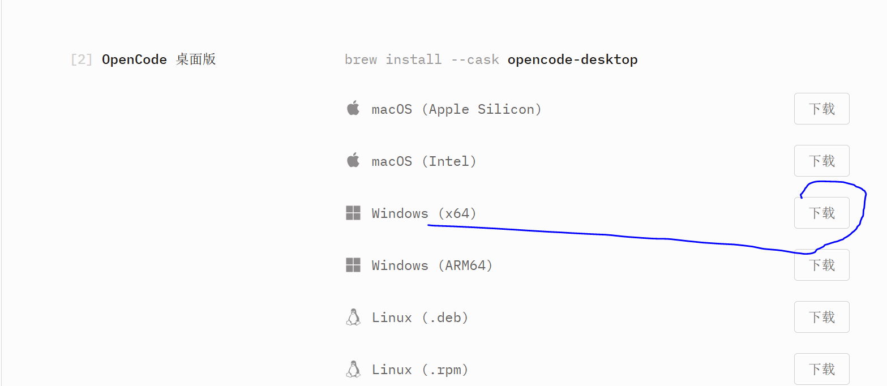
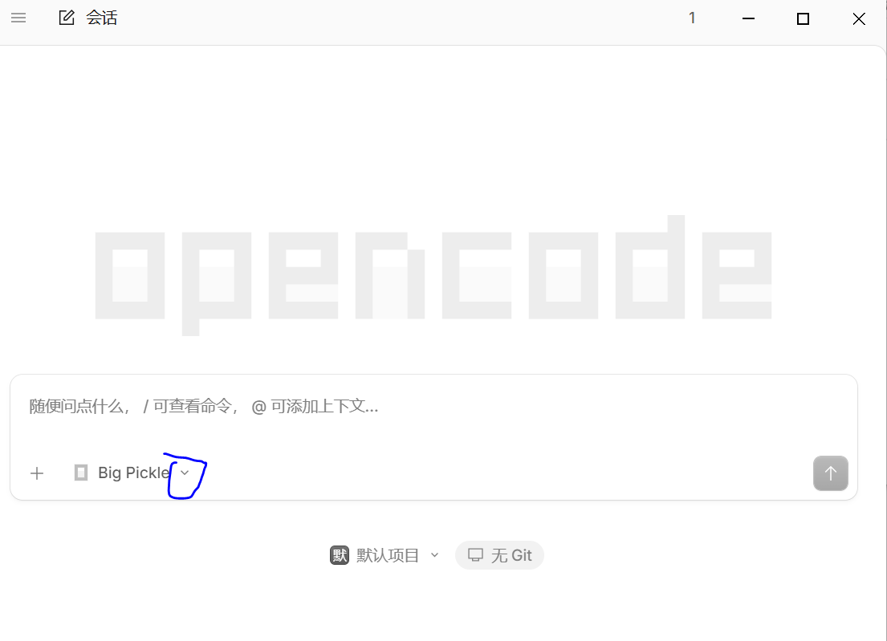

# OpenCode 安装与 Higress AI Gateway 接入指南

本指南介绍如何安装 **OpenCode 桌面版** 并一键导入 **Higress AI Gateway** 模型配置（含 `gemini-4-argon`、`gemini-4-argon-search`、`gemini-3.8-flash`、`kimi-k3`、`glm-5.3`、`gpt-5.6-luna`）。

---

## 一、下载并安装 OpenCode 桌面版

1. 访问官方下载页：**https://opencode.ai/download**
2. 在 **`[2] OpenCode 桌面版`** 区域，下载对应系统的安装包并安装：
   - **Windows**：选择 **`Windows (x64)`** 点击 **`下载`**（双击 `opencode-desktop-win-x64.exe` 安装）。
   - **macOS**：Apple 芯片选择 `macOS (Apple Silicon)`，Intel 芯片选择 `macOS (Intel)`。



---

## 二、一键导入 Higress 模型配置

将下方脚本中的 `<YOUR_HIGRESS_API_KEY>` 替换为你的专属 API Key，复制到终端运行即可自动导入全部模型。

### 1. Windows（打开 PowerShell 运行）

```powershell
$HIGRESS_KEY = "<YOUR_HIGRESS_API_KEY>"

mkdir -Force "$HOME\.config\opencode", "$HOME\.local\share\opencode" | Out-Null

@"
{
  "`$schema": "https://opencode.ai/config.json",
  "model": "my-higress/gemini-4-argon",
  "provider": {
    "my-higress": {
      "npm": "@ai-sdk/openai-compatible",
      "name": "my-higress",
      "options": {
        "baseURL": "https://higress.jppwl.asia/v1",
        "apiKey": "$HIGRESS_KEY"
      },
      "models": {
        "gemini-4-argon": { "name": "Gemini 4 Argon (1M)", "tool_call": true, "limit": { "context": 1048576, "output": 65536 } },
        "gemini-4-argon-search": { "name": "Gemini 4 Argon Search", "tool_call": true, "limit": { "context": 1048576, "output": 65536 } },
        "gemini-3.8-flash": { "name": "Gemini 3.8 Flash (1M)", "tool_call": true, "limit": { "context": 1048576, "output": 65536 } },
        "kimi-k3": { "name": "Kimi K3", "tool_call": true, "limit": { "context": 262144, "output": 32768 } },
        "glm-5.3": { "name": "GLM 5.3", "tool_call": true, "limit": { "context": 131072, "output": 32768 } },
        "gpt-5.6-luna": { "name": "GPT 5.6 Luna", "tool_call": true, "limit": { "context": 131072, "output": 32768 } }
      }
    }
  },
  "providers": {
    "my-higress": {
      "name": "my-higress",
      "package": "@opencode/ai/providers/openai-compatible",
      "settings": {
        "baseURL": "https://higress.jppwl.asia/v1",
        "apiKey": "$HIGRESS_KEY"
      },
      "models": {
        "gemini-4-argon": { "name": "Gemini 4 Argon (1M)", "capabilities": { "tools": true, "input": ["text", "image"], "output": ["text"] }, "limit": { "context": 1048576, "output": 65536 } },
        "gemini-4-argon-search": { "name": "Gemini 4 Argon Search", "capabilities": { "tools": true, "input": ["text", "image"], "output": ["text"] }, "limit": { "context": 1048576, "output": 65536 } },
        "gemini-3.8-flash": { "name": "Gemini 3.8 Flash (1M)", "capabilities": { "tools": true, "input": ["text", "image"], "output": ["text"] }, "limit": { "context": 1048576, "output": 65536 } },
        "kimi-k3": { "name": "Kimi K3", "capabilities": { "tools": true, "input": ["text"], "output": ["text"] }, "limit": { "context": 262144, "output": 32768 } },
        "glm-5.3": { "name": "GLM 5.3", "capabilities": { "tools": true, "input": ["text"], "output": ["text"] }, "limit": { "context": 131072, "output": 32768 } },
        "gpt-5.6-luna": { "name": "GPT 5.6 Luna", "capabilities": { "tools": true, "input": ["text"], "output": ["text"] }, "limit": { "context": 131072, "output": 32768 } }
      }
    }
  }
}
"@ | Set-Content -Encoding UTF8 "$HOME\.config\opencode\opencode.json"

@"
{
  "my-higress": {
    "type": "api",
    "key": "$HIGRESS_KEY"
  }
}
"@ | Set-Content -Encoding UTF8 "$HOME\.local\share\opencode\auth.json"

Write-Host "✅ Higress 配置已导入，请重启 OpenCode 桌面版。" -ForegroundColor Green
```

### 2. macOS / Linux（打开 Terminal 运行）

```bash
export HIGRESS_KEY="<YOUR_HIGRESS_API_KEY>"

mkdir -p ~/.config/opencode ~/.local/share/opencode

cat << EOF > ~/.config/opencode/opencode.json
{
  "\$schema": "https://opencode.ai/config.json",
  "model": "my-higress/gemini-4-argon",
  "provider": {
    "my-higress": {
      "npm": "@ai-sdk/openai-compatible",
      "name": "my-higress",
      "options": {
        "baseURL": "https://higress.jppwl.asia/v1",
        "apiKey": "${HIGRESS_KEY}"
      },
      "models": {
        "gemini-4-argon": { "name": "Gemini 4 Argon (1M)", "tool_call": true, "limit": { "context": 1048576, "output": 65536 } },
        "gemini-4-argon-search": { "name": "Gemini 4 Argon Search", "tool_call": true, "limit": { "context": 1048576, "output": 65536 } },
        "gemini-3.8-flash": { "name": "Gemini 3.8 Flash (1M)", "tool_call": true, "limit": { "context": 1048576, "output": 65536 } },
        "kimi-k3": { "name": "Kimi K3", "tool_call": true, "limit": { "context": 262144, "output": 32768 } },
        "glm-5.3": { "name": "GLM 5.3", "tool_call": true, "limit": { "context": 131072, "output": 32768 } },
        "gpt-5.6-luna": { "name": "GPT 5.6 Luna", "tool_call": true, "limit": { "context": 131072, "output": 32768 } }
      }
    }
  },
  "providers": {
    "my-higress": {
      "name": "my-higress",
      "package": "@opencode/ai/providers/openai-compatible",
      "settings": {
        "baseURL": "https://higress.jppwl.asia/v1",
        "apiKey": "${HIGRESS_KEY}"
      },
      "models": {
        "gemini-4-argon": { "name": "Gemini 4 Argon (1M)", "capabilities": { "tools": true, "input": ["text", "image"], "output": ["text"] }, "limit": { "context": 1048576, "output": 65536 } },
        "gemini-4-argon-search": { "name": "Gemini 4 Argon Search", "capabilities": { "tools": true, "input": ["text", "image"], "output": ["text"] }, "limit": { "context": 1048576, "output": 65536 } },
        "gemini-3.8-flash": { "name": "Gemini 3.8 Flash (1M)", "capabilities": { "tools": true, "input": ["text", "image"], "output": ["text"] }, "limit": { "context": 1048576, "output": 65536 } },
        "kimi-k3": { "name": "Kimi K3", "capabilities": { "tools": true, "input": ["text"], "output": ["text"] }, "limit": { "context": 262144, "output": 32768 } },
        "glm-5.3": { "name": "GLM 5.3", "capabilities": { "tools": true, "input": ["text"], "output": ["text"] }, "limit": { "context": 131072, "output": 32768 } },
        "gpt-5.6-luna": { "name": "GPT 5.6 Luna", "capabilities": { "tools": true, "input": ["text"], "output": ["text"] }, "limit": { "context": 131072, "output": 32768 } }
      }
    }
  }
}
EOF

cat << EOF > ~/.local/share/opencode/auth.json
{
  "my-higress": {
    "type": "api",
    "key": "${HIGRESS_KEY}"
  }
}
EOF

echo "✅ Higress 配置已导入，请重启 OpenCode 桌面版。"
```

---

## 三、重启并选择模型

1. 完全退出并重新打开 **OpenCode 桌面版**。
2. 点击主界面左下角的模型下拉框（`⌄`），搜索 `gemini` 或 `higress`，即可切换使用：
   - **`Gemini 4 Argon (1M)`**（默认主力模型）
   - **`Gemini 4 Argon Search`**（带联网搜索）
   - **`Gemini 3.8 Flash (1M)`**
   - **`Kimi K3` / `GLM 5.3` / `GPT 5.6 Luna`**



---

## 附：网关参数速查表

| 配置项 | 参数值 |
| :--- | :--- |
| **协议类型** | OpenAI Compatible (`/v1/chat/completions`) |
| **Base URL** | `https://higress.jppwl.asia/v1` |
| **API Key** | `<YOUR_HIGRESS_API_KEY>` |
| **可用模型 ID** | `gemini-4-argon`、`gemini-4-argon-search`、`gemini-3.8-flash`、`kimi-k3`、`glm-5.3`、`gpt-5.6-luna` |
