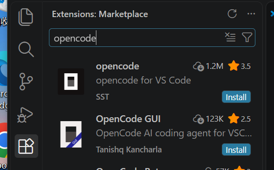
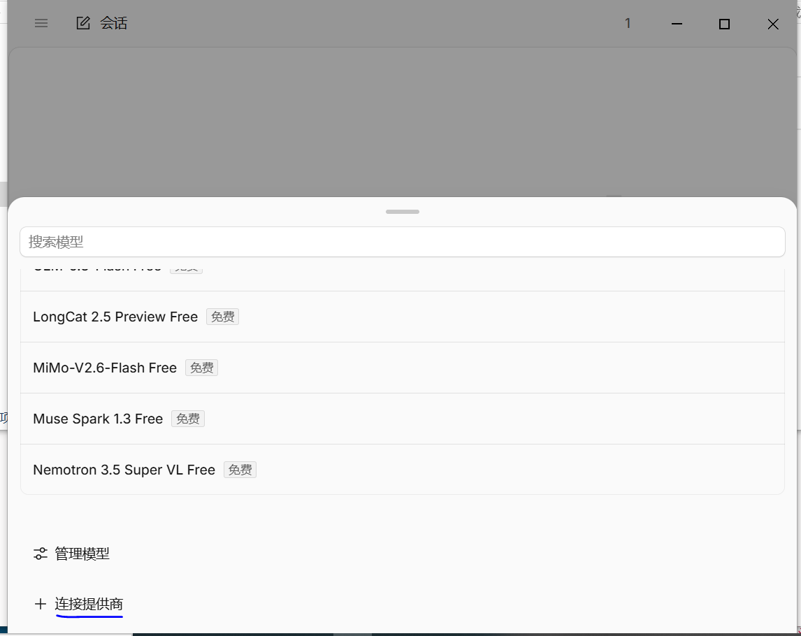
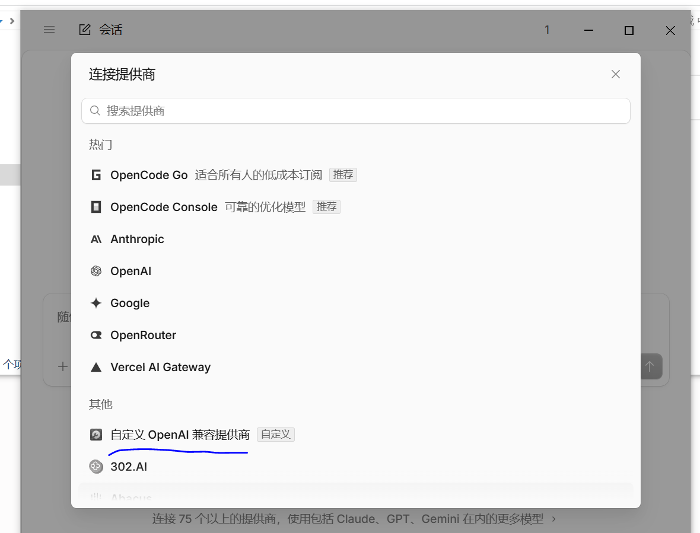
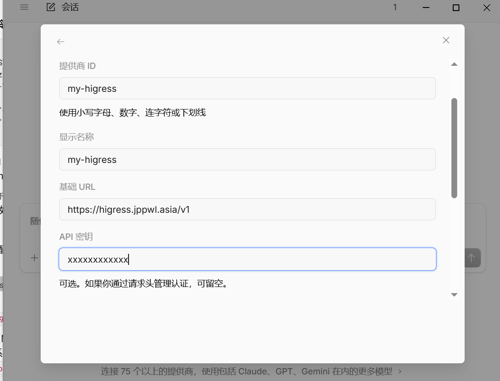
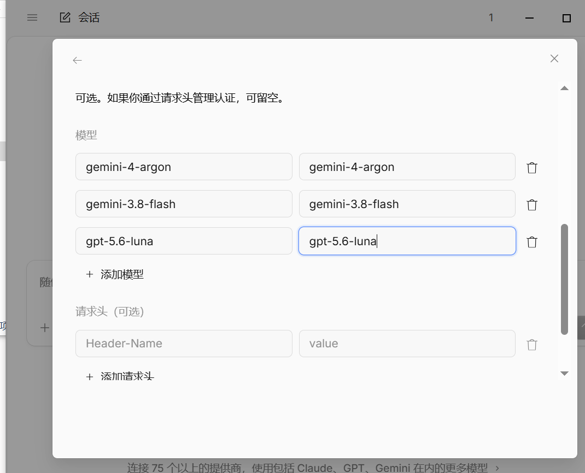
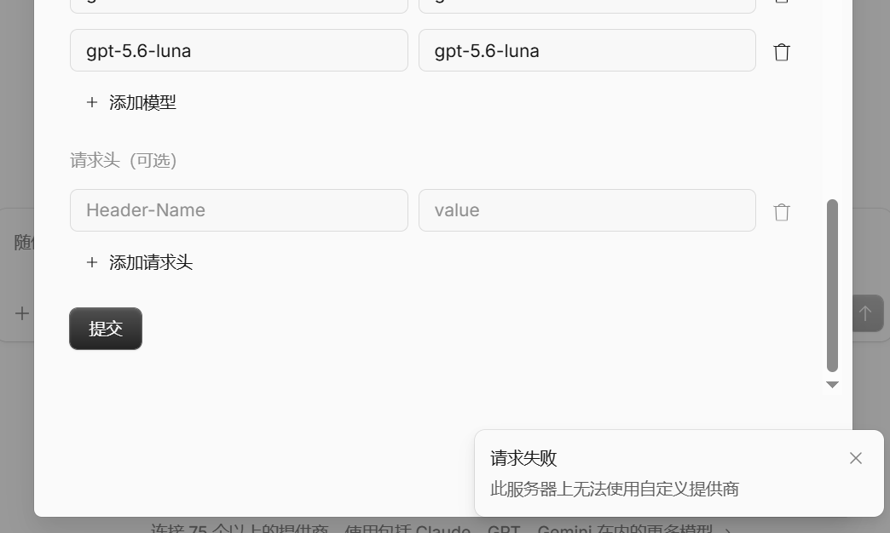

# OpenCode 安装与 Higress AI Gateway 接入图文手把手教程

本文档记录 **OpenCode（桌面版 + VS Code 官方扩展）** 的完整安装流程，以及如何绕过 OpenCode Desktop v2.0 图形界面的自定义提供商提交 Bug，一键导入 **Higress AI Gateway** 的多模型配置（`gemini-4-argon`、`gemini-4-argon-search`、`gemini-3.8-flash`、`kimi-k3`、`glm-5.3`、`gpt-5.6-luna`）。

---

## 一、下载与安装 OpenCode

### 1. 安装 OpenCode 桌面版（独立图形客户端 + 内置 CLI）

1. 访问官方下载页：**https://opencode.ai/download**
2. 在 **`[2] OpenCode 桌面版`** 区域，根据操作系统下载对应安装包：
   - **Windows (x64)**：下载 `opencode-desktop-win-x64.exe` 并双击安装。
   - **macOS**：Apple 芯片选择 `macOS (Apple Silicon)`，Intel 芯片选择 `macOS (Intel)`。


### 2. （可选）在 VS Code 中安装官方扩展插件

如果日常在 **VS Code** 中进行代码开发，可配合安装官方 VS Code 扩展：

1. 打开 VS Code 左侧 **Extensions（扩展市场）**，搜索 **`opencode`**。
2. 选择第一个由 **`SST`** 发布的 **`opencode`**（下载量 1.2M+ 的官方插件），点击 **`Install`**。
   - **注意**：第一个 `SST` 发布的才是官方终端联动扩展；第二个 `OpenCode GUI` 为个人开发者维护的第三方 Webview 壳，无需安装。



#### 常见问题：VS Code 终端报错 `无法将“opencode”项识别为 cmdlet`

VS Code 的 `opencode` 插件本身只是一个启动器（在 VS Code 中新建终端并执行 `opencode` 命令），不会自动将 CLI 写入系统环境变量。

在安装完 **OpenCode 桌面版** 后，只需在 Windows PowerShell 中执行以下命令，将桌面版内置的 `opencode-cli.exe` 复制到系统默认 `PATH` 目录（`WindowsApps`），即可在 VS Code 终端中直接唤起：

```powershell
Copy-Item "$env:APPDATA\ai.opencode.desktop\cli\*\opencode-cli.exe" "$env:LOCALAPPDATA\Microsoft\WindowsApps\opencode.exe" -Force
```

如果未安装桌面版，也可直接从 GitHub Release 拉取独立单文件 CLI 放入 `PATH`：

```powershell
curl.exe -L https://github.com/anomalyco/opencode/releases/latest/download/opencode-windows-x64.zip -o "$HOME\opencode-win.zip"
tar -xf "$HOME\opencode-win.zip" -C "$env:LOCALAPPDATA\Microsoft\WindowsApps"
del "$HOME\opencode-win.zip"
```

---

## 二、OpenCode 桌面版自定义提供商配置与 GUI 避坑说明

### 1. 图形界面的常规入口

打开 OpenCode 桌面版后，主界面左下角默认选中的是内置免费模型 **`Big Pickle`**：


点击下拉箭头后，图形界面的配置路径为：
1. 点击底部 **`+ 连接提供商`**；
2. 向下滚动到 **`其他`** 分类，选择 **`自定义 OpenAI 兼容提供商`**；
3. 填入提供商 ID（`my-higress`）、基础 URL（`https://higress.jppwl.asia/v1`）、API 密钥（`<YOUR_HIGRESS_API_KEY>`）以及模型列表。

| 1. 点击连接提供商 | 2. 选择自定义 OpenAI 兼容提供商 |
| :---: | :---: |
|  |  |

| 3. 填写提供商与 API Key | 4. 添加模型 ID 列表 |
| :---: | :---: |
|  |  |

### 2. 为什么在 GUI 中点击“提交”会报错？

在 OpenCode Desktop v2.0（如 `v2.0.14` ~ `v2.0.32`）中，填完上述表单并点击 **`提交`** 时，右下角会弹出报错 Toast：**`请求失败：此服务器上无法使用自定义提供商`**：



**4 行源码真相（GitHub Issue `#50650` / `#51330`）**：  
OpenCode 在升级 v2 架构时，前端保留了自定义提供商的表单 UI，但在 `packages/app/src/providers/credentials/dialog.tsx` 的提交回调中硬编码了未实现的抛错占位符：

```ts
mutationFn: async (result) => {
  // TODO: Restore custom providers when V2 exposes config and arbitrary credential APIs.
  throw new Error(language.t("provider.custom.unavailable"))
}
```

因此，**不要在图形弹窗里手动填写并点提交**，直接通过下方第三步的命令行脚本将配置写入本地 `~/.config/opencode/opencode.json`，OpenCode 底层服务即可正常加载全部自定义模型。

---

## 三、一键导入 Higress AI Gateway 配置文件（推荐做法）

将下方命令中的 `<YOUR_HIGRESS_API_KEY>` 替换为你自己的专属 API Key，复制到终端执行即可一键完成配置。

### 1. Windows 电脑（打开 PowerShell 执行）

```powershell
$HIGRESS_KEY = "<YOUR_HIGRESS_API_KEY>"

mkdir -Force "$HOME\.config\opencode", "$HOME\.local\share\opencode" | Out-Null

@"
{
  "`$schema": "https://opencode.ai/config.json",
  "model": "my-higress/gemini-4-argon",
  "provider": {
    "my-higress": {
      "npm": "@ai-sdk/openai-compatible",
      "name": "my-higress",
      "options": {
        "baseURL": "https://higress.jppwl.asia/v1",
        "apiKey": "$HIGRESS_KEY"
      },
      "models": {
        "gemini-4-argon": { "name": "Gemini 4 Argon (1M)", "tool_call": true, "limit": { "context": 1048576, "output": 65536 } },
        "gemini-4-argon-search": { "name": "Gemini 4 Argon Search", "tool_call": true, "limit": { "context": 1048576, "output": 65536 } },
        "gemini-3.8-flash": { "name": "Gemini 3.8 Flash (1M)", "tool_call": true, "limit": { "context": 1048576, "output": 65536 } },
        "kimi-k3": { "name": "Kimi K3", "tool_call": true, "limit": { "context": 262144, "output": 32768 } },
        "glm-5.3": { "name": "GLM 5.3", "tool_call": true, "limit": { "context": 131072, "output": 32768 } },
        "gpt-5.6-luna": { "name": "GPT 5.6 Luna", "tool_call": true, "limit": { "context": 131072, "output": 32768 } }
      }
    }
  },
  "providers": {
    "my-higress": {
      "name": "my-higress",
      "package": "@opencode/ai/providers/openai-compatible",
      "settings": {
        "baseURL": "https://higress.jppwl.asia/v1",
        "apiKey": "$HIGRESS_KEY"
      },
      "models": {
        "gemini-4-argon": { "name": "Gemini 4 Argon (1M)", "capabilities": { "tools": true, "input": ["text", "image"], "output": ["text"] }, "limit": { "context": 1048576, "output": 65536 } },
        "gemini-4-argon-search": { "name": "Gemini 4 Argon Search", "capabilities": { "tools": true, "input": ["text", "image"], "output": ["text"] }, "limit": { "context": 1048576, "output": 65536 } },
        "gemini-3.8-flash": { "name": "Gemini 3.8 Flash (1M)", "capabilities": { "tools": true, "input": ["text", "image"], "output": ["text"] }, "limit": { "context": 1048576, "output": 65536 } },
        "kimi-k3": { "name": "Kimi K3", "capabilities": { "tools": true, "input": ["text"], "output": ["text"] }, "limit": { "context": 262144, "output": 32768 } },
        "glm-5.3": { "name": "GLM 5.3", "capabilities": { "tools": true, "input": ["text"], "output": ["text"] }, "limit": { "context": 131072, "output": 32768 } },
        "gpt-5.6-luna": { "name": "GPT 5.6 Luna", "capabilities": { "tools": true, "input": ["text"], "output": ["text"] }, "limit": { "context": 131072, "output": 32768 } }
      }
    }
  }
}
"@ | Set-Content -Encoding UTF8 "$HOME\.config\opencode\opencode.json"

@"
{
  "my-higress": {
    "type": "api",
    "key": "$HIGRESS_KEY"
  }
}
"@ | Set-Content -Encoding UTF8 "$HOME\.local\share\opencode\auth.json"

Write-Host "✅ Higress 配置已成功写入！请重启 OpenCode 桌面版。" -ForegroundColor Green
```

### 2. macOS / Linux 电脑（打开 Terminal 执行）

```bash
export HIGRESS_KEY="<YOUR_HIGRESS_API_KEY>"

mkdir -p ~/.config/opencode ~/.local/share/opencode

cat << EOF > ~/.config/opencode/opencode.json
{
  "\$schema": "https://opencode.ai/config.json",
  "model": "my-higress/gemini-4-argon",
  "provider": {
    "my-higress": {
      "npm": "@ai-sdk/openai-compatible",
      "name": "my-higress",
      "options": {
        "baseURL": "https://higress.jppwl.asia/v1",
        "apiKey": "${HIGRESS_KEY}"
      },
      "models": {
        "gemini-4-argon": { "name": "Gemini 4 Argon (1M)", "tool_call": true, "limit": { "context": 1048576, "output": 65536 } },
        "gemini-4-argon-search": { "name": "Gemini 4 Argon Search", "tool_call": true, "limit": { "context": 1048576, "output": 65536 } },
        "gemini-3.8-flash": { "name": "Gemini 3.8 Flash (1M)", "tool_call": true, "limit": { "context": 1048576, "output": 65536 } },
        "kimi-k3": { "name": "Kimi K3", "tool_call": true, "limit": { "context": 262144, "output": 32768 } },
        "glm-5.3": { "name": "GLM 5.3", "tool_call": true, "limit": { "context": 131072, "output": 32768 } },
        "gpt-5.6-luna": { "name": "GPT 5.6 Luna", "tool_call": true, "limit": { "context": 131072, "output": 32768 } }
      }
    }
  },
  "providers": {
    "my-higress": {
      "name": "my-higress",
      "package": "@opencode/ai/providers/openai-compatible",
      "settings": {
        "baseURL": "https://higress.jppwl.asia/v1",
        "apiKey": "${HIGRESS_KEY}"
      },
      "models": {
        "gemini-4-argon": { "name": "Gemini 4 Argon (1M)", "capabilities": { "tools": true, "input": ["text", "image"], "output": ["text"] }, "limit": { "context": 1048576, "output": 65536 } },
        "gemini-4-argon-search": { "name": "Gemini 4 Argon Search", "capabilities": { "tools": true, "input": ["text", "image"], "output": ["text"] }, "limit": { "context": 1048576, "output": 65536 } },
        "gemini-3.8-flash": { "name": "Gemini 3.8 Flash (1M)", "capabilities": { "tools": true, "input": ["text", "image"], "output": ["text"] }, "limit": { "context": 1048576, "output": 65536 } },
        "kimi-k3": { "name": "Kimi K3", "capabilities": { "tools": true, "input": ["text"], "output": ["text"] }, "limit": { "context": 262144, "output": 32768 } },
        "glm-5.3": { "name": "GLM 5.3", "capabilities": { "tools": true, "input": ["text"], "output": ["text"] }, "limit": { "context": 131072, "output": 32768 } },
        "gpt-5.6-luna": { "name": "GPT 5.6 Luna", "capabilities": { "tools": true, "input": ["text"], "output": ["text"] }, "limit": { "context": 131072, "output": 32768 } }
      }
    }
  }
}
EOF

cat << EOF > ~/.local/share/opencode/auth.json
{
  "my-higress": {
    "type": "api",
    "key": "${HIGRESS_KEY}"
  }
}
EOF

echo "✅ Higress 配置已成功写入！请重启 OpenCode 桌面版。"
```

---

## 四、验证与选择模型

1. **通过命令行验证模型加载与连通性**：
   ```bash
   # 查看已识别的 Higress 模型列表
   opencode models | grep higress

   # 测试调用 gemini-4-argon
   opencode run -m my-higress/gemini-4-argon "Reply OK"
   ```
2. **在桌面版中选择模型**：
   - 完全退出并重新打开 **OpenCode 桌面版**；
   - 点击左下角模型选择框（`⌄`），搜索 `gemini` 或 `higress`，即可直接选用 `Gemini 4 Argon (1M)`、`Gemini 3.8 Flash (1M)`、`Kimi K3`、`GLM 5.3`、`GPT 5.6 Luna`。

---

## 附：网关参数速查表

| 配置项 | 参数值 |
| :--- | :--- |
| **提供商 ID** | `my-higress` |
| **协议类型** | OpenAI Compatible (`/v1/chat/completions`) |
| **Base URL** | `https://higress.jppwl.asia/v1` |
| **API Key** | `<YOUR_HIGRESS_API_KEY>`（联系管理员获取专属 Virtual Key） |
| **可用模型 ID** | `gemini-4-argon`、`gemini-4-argon-search`、`gemini-3.8-flash`、`kimi-k3`、`glm-5.3`、`gpt-5.6-luna` |
